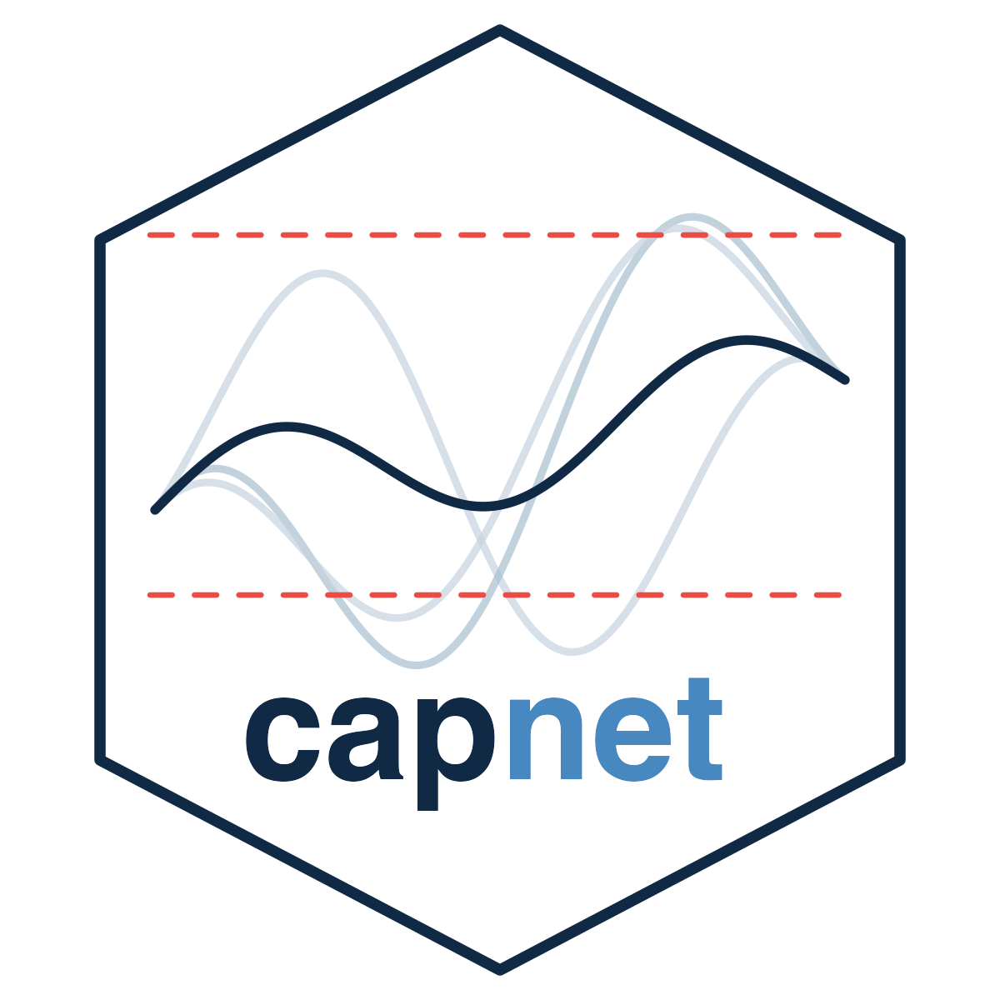

# capnet

**Contribution-capped elastic net regularization for R.**

A differentiable penalty on what each feature *actually does to a prediction* — not just the size of its coefficient. Ships with GLM support (Gaussian, binomial, Poisson, Gamma), cross-validation, walk-forward backtesting, and diagnostic plotting, fit end-to-end with a custom OWL-QN/L-BFGS objective built on the `lbfgs` package.


---

## Why this exists

Financial and web-scale features are routinely fat-tailed, and the extreme values are often real signal — a regime shift, a viral spike — not noise to discard. Standard L1/L2 penalties don't help: they shrink *coefficients*, not realized influence, so a feature with an occasional extreme value can still swing a prediction whenever that value occurs, "small" coefficient or not. The usual workarounds — winsorization, outlier filtering, post-fit truncation — throw away exactly the information that made the extreme value informative, with no guarantee they've actually bounded the model's dependence on any given feature.

`capnet` penalizes the *deployed* effect of each feature directly. It's a portfolio-construction idea applied to regression: concentrating a portfolio in one asset increases risk; concentrating a model's predictive weight in one feature increases model risk. `capnet` bounds that concentration explicitly, per feature, while still letting the optimizer use the full training signal — including the extremes.

The same mechanism generalizes past finance to credit scoring and fairness-constrained models (bounding a sensitive or proxy covariate's influence), clinical risk scores (a single noisy biomarker shouldn't dominate), and any regression over unstable or non-stationary feature scales.

## Methodology

`capnet` fits a GLM under an elastic net penalty augmented with a smooth contribution-cap penalty:

```math
\min_{\beta_0,\ \beta}\ \; \ell(\beta_0, \beta;\, X, y) \;+\; \lambda\Big(\alpha\|\beta\|_1 + (1-\alpha)\|\beta\|_2^2\Big) \;+\; \gamma \sum_{i,j} \max\big(0,\ |\beta_j Z_{ij} \cdot m_i| - L_j\big)^2
```

- `ℓ` is the negative log-likelihood for `family` (`gaussian`, `binomial`, `poisson`, or `Gamma` with a log link).
- `λ`, `α` are the usual elastic net strength and L1/L2 mixing parameter.
- `Z` is an evaluation matrix (defaults to `X`) on which contributions are measured — it can differ from the training data, e.g. an out-of-sample or live-trading feature matrix.
- `L` is a per-feature contribution ceiling; `m` (`multiplier`) optionally rescales contributions row-by-row (e.g. per-observation notional or exposure) without touching the likelihood term.
- `γ` controls how strongly cap violations are penalized; `γ = 0` recovers plain elastic net.

The cap penalty is a squared hinge. Unbounded fits use **OWL-QN** when the L1 term is active and **L-BFGS** otherwise, through the `lbfgs` package. Fits with finite coefficient bounds use a projected proximal-gradient optimizer. When `standardize = TRUE` (the default), likelihood and ridge terms are optimized on standardized variables for numerical stability, while the cap penalty and its gradient are evaluated on the original contribution scale. This keeps `L` and `Z` in the units of the raw data.

## Engineering notes

- **Verified gradients.** Each of the four supported GLM families has a hand-derived analytic gradient, checked against numerical (finite-difference) gradients in a dedicated regression suite (`tests/testthat/test-gradients.R`) — including a regression test for a scale-invariance bug in the contribution-cap gradient's chain-rule term.
- **Optimizer selection.** Unbounded fits use OWL-QN or L-BFGS according to the penalty; finite coefficient bounds use projected proximal gradient.
- **Standardization done right.** Optimization happens on standardized data for numerical conditioning, but the cap penalty — the part users actually reason about — is always defined and enforced in the original feature scale.
- **Box constraints**, K-fold cross-validation and walk-forward evaluation with automatic `gamma` back-off on non-convergence, and parallel dispatch over folds/steps via `parallel::makeCluster()`.
- **Idiomatic R package design.** S3 classes (`capnet`, `cv_capnet`, `walk_capnet`, `capnet_path`) with `coef()`, `predict()`, and `plot()` methods, `glmnet`-compatible `alpha`/`lambda` conventions, and roxygen2-generated documentation throughout.

## Installation

```r
remotes::install_github("harryziyuhe/capnet")
```

## Quick start

```r
library(capnet)

# Simulated data with a suggested per-feature contribution cap
d <- simulate_capnet_data(n = 200, p = 15, seed = 1)

fit <- capnet(d$X, d$y, L = d$L, alpha = 0.5, lambda = 0.1, gamma = 1)

coef(fit)
fit$feature_contributions   # per-row, per-feature contribution to the fit

# Any row/feature still exceeding its cap?
capnet_violations(fit)
```

Select hyperparameters by cross-validation, then compare against an uncapped fit:

```r
cv <- cv_capnet(d$X, d$y, gamma = 1, L = d$L)

fit_capped   <- capnet(d$X, d$y, L = d$L, alpha = cv$best_alpha,
                        lambda = cv$best_lambda, gamma = 1)
fit_uncapped <- capnet(d$X, d$y, L = d$L, alpha = cv$best_alpha,
                        lambda = cv$best_lambda, gamma = 0)

plot_redistribution(fit_uncapped, fit_capped, plot = "delta")
```

`walk_capnet()` runs the same fit across a time-ordered evaluation matrix, one window at a time, retrying with a smaller `gamma` if the optimizer fails to converge:

```r
out <- walk_capnet(d$X, d$y, L = d$L, z = d$X, walk = 1,
                    alpha = 0.5, lambda = 0.1, gamma = 1)
```

## API

| Function | Description |
|---|---|
| `capnet()` | Fit a single elastic net + contribution-cap model |
| `cv_capnet()` | K-fold cross-validation over an `alpha` x `lambda` grid (`gamma`, `L` fixed) |
| `walk_capnet()` | Walk-forward refitting and out-of-sample prediction over an evaluation matrix |
| `coef_path()` | Coefficients along a `lambda` (or other hyperparameter) path |
| `capnet_violations()` | Which (row, feature) pairs exceed their contribution cap |
| `plot_redistribution()` | Visualize how coefficients/contributions shift as caps tighten |
| `simulate_capnet_data()` | Synthetic data generator (Gaussian/binomial/Poisson/Gamma, with an optional unstable-feature "proxy" mode) for examples and benchmarking |

`cv_capnet()` and `walk_capnet()` both accept `parallel = TRUE` to dispatch independent fits across a `parallel::makeCluster()` cluster.

## Supported families

`gaussian` (identity link), `binomial` (logit), `poisson` (log), and `Gamma` (log link only — the log link, not `stats::Gamma()`'s inverse-link default, is what matches this package's loss and gradient). Pass `family` as a string, a family-generating function, or a family object, same as `glm()`.

## Relationship to `glmnet`

`capnet` is not a performance-oriented replacement for `glmnet` — it targets the narrower case where you need a differentiable cap on realized feature contributions, which off-the-shelf coordinate-descent solvers can't express. Where the two overlap (`gamma = 0`), `capnet` is designed as a rough drop-in, using the same `alpha`/`lambda` conventions; where they diverge, `capnet` trades `glmnet`'s coordinate-descent speed for OWL-QN/L-BFGS generality over an arbitrary evaluation matrix `Z` and row-wise `multiplier`.

## Documentation

- `vignette("capnet_guide")` — contribution-cap formulation, optimization strategy, and examples

Comparison and case-study vignette drafts, along with the paper manuscript,
are available in the source repository but are not included in the CRAN package.

## Development

```r
devtools::install_deps()
devtools::document()
devtools::test()
devtools::check()
```

## License

GPL (>= 2) © Harry He
